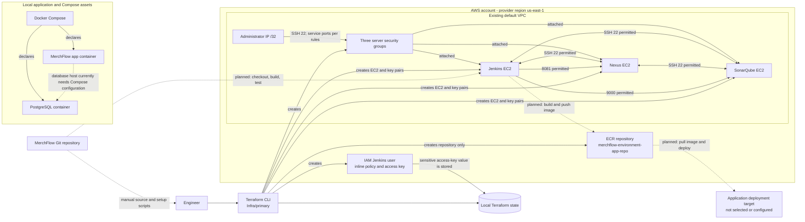

# MerchFlow AWS Infrastructure Project

MerchFlow is a hands-on infrastructure and DevOps project. Its primary focus is provisioning and connecting AWS resources with Terraform; the Spring Boot application is the sample workload the infrastructure is intended to support.

## Current state at a glance

- Terraform provisions Jenkins, Nexus Repository Manager, SonarQube EC2 instances, their security groups and key pairs, an IAM user, and an ECR repository.
- Terraform uses the AWS default VPC. It does not create a VPC, subnets, or routing.
- Setup scripts install Jenkins, Nexus, and SonarQube, but Terraform does not run those scripts.
- ECR is provisioned, but no checked-in pipeline builds or pushes an image to it.
- The repository does not yet configure ECS, an application deployment, or a complete CI/CD workflow.

The [Roadmap](./Roadmap.md) describes intended future work and should not be read as a list of already implemented features.

## Architecture

Solid arrows represent resources and network rules currently defined in the repository. Dashed arrows represent planned or incomplete flows. A security-group rule permits traffic but does not install or start the service on an EC2 instance.



### AWS resources and connectivity

`Infra/primary` composes the modules in `Infra/modules`:

| Module | Current responsibility |
| --- | --- |
| `security` | Looks up the default VPC and creates separate security groups for Jenkins, Nexus, and SonarQube. |
| `jenkins` | Creates a Jenkins EC2 instance, a key pair from the supplied public key, and a 20 GiB `gp3` root volume. |
| `nexus` | Creates a Nexus EC2 instance, a key pair, and a 20 GiB `gp3` root volume. |
| `sonar` | Creates a SonarQube EC2 instance, a key pair, and a 20 GiB `gp3` root volume. |
| `iam` | Creates an IAM user, inline policy, and long-lived access key. |
| `ecr` | Creates an ECR repository named `merchflow-${var.environment}-app-repo`. |

The security groups allow administrator SSH from the configured single IPv4 `/32` and SSH between all three server groups. They also allow:

- Jenkins: TCP 80 and 8080 from the administrator IP; TCP 8080 from Nexus and SonarQube.
- Nexus: TCP 8081 from the administrator IP and Jenkins.
- SonarQube: TCP 9000 from the administrator IP and Jenkins.
- All three groups: unrestricted outbound traffic.

The SonarQube setup script configures Nginx on port 80, but the SonarQube security group does not currently allow inbound port 80. The instances have no Terraform `user_data` or configuration-management connection, so creating an instance does not install or configure its service.

The ECR module enables scan-on-push, AES256 encryption, mutable tags, and `force_delete` by default. `force_delete` permits Terraform to delete a repository even when it contains images. The module does not create images.

### IAM and state considerations

The IAM inline policy grants `ecr:*` and `ecs:*` on all resources, plus `s3:ListAllMyBuckets` and `ec2:Describe*`. The user is not attached to an EC2 instance profile, and no ECS cluster, service, or task definition is provisioned.

Terraform creates an IAM access key and exposes its secret through a sensitive output. Marking an output sensitive hides it in normal CLI output but does not remove it from Terraform state. The current configuration uses local state and has no shared remote backend. Protect the state file and do not commit it or share the access key.

## Provisioning the AWS infrastructure

### Prerequisites

- Terraform
- AWS credentials configured for the account in which resources should be created
- An SSH public key file for the EC2 key pairs
- `Infra/primary/terraform.tfvars` with values for the required primary inputs

`terraform.tfvars`, Terraform state, and key files are ignored by Git. Required inputs include `environment`, `region`, `ubuntu_ami_id`, `amazon_linux_ami_id`, `app_public_key_path`, and `my_ip_cidr`. Instance types and IAM values have defaults. Set `my_ip_cidr` to the administrator's public IPv4 address with a `/32` mask.

The provider in `Infra/primary/provider.tf` is currently hard-coded to `us-east-1`; the required `region` variable is not wired into the provider. The `app_public_key_path` is resolved relative to each service module.

From the repository root, initialize and review the plan before applying:

```powershell
terraform -chdir=Infra/primary init
terraform -chdir=Infra/primary fmt -check
terraform -chdir=Infra/primary validate
terraform -chdir=Infra/primary plan
terraform -chdir=Infra/primary apply
```

Applying the configuration can create billable EC2 resources. Review the plan and the target AWS account before approving an apply. The primary stack currently exports IAM user and access-key outputs; it does not re-export the ECR repository or EC2 instance details.

## Server installation scripts

These scripts are separate from Terraform and must be reviewed and run manually on the appropriate hosts:

- `jenkins-setup.sh` installs Java and Jenkins.
- `nexus-setup.sh` installs Java and Nexus Repository Manager.
- `sonar-setup.sh` installs Java, PostgreSQL, SonarQube, and Nginx, then reboots the server.

The SonarQube script contains hard-coded database credentials. Replace them before use and rotate them if they have already been used. Do not copy secrets into the README, source control, or Terraform variables.

## Application and container assets

The application is a Java 17 / Spring Boot REST API for categories, products, warehouses, inventory, customers, orders, simulated payments, and shipments. It is the example workload, not the focus of this infrastructure project. It has no application authentication configured.

`Docker-files/app/Dockerfile` packages the WAR and runs it in Tomcat 10.1. `Docker-files/db/Dockerfile` uses PostgreSQL 17 and initializes a new database volume with `Docker-files/db/backup.sql`, which contains schema and sample data.

`compose.yaml` declares the app and PostgreSQL services with persistent volumes, but it is not currently configured for a working end-to-end startup:

- The application datasource defaults to `localhost:5432`; from the app container, the database host should be the Compose service name `merchflowdb`.
- The app service does not currently receive database connection settings.
- The database image sets `POSTGRES_PASSWORD_FILE`, while Compose sets `POSTGRES_PASSWORD`; the official PostgreSQL entrypoint rejects both being set at once.

The test suite currently contains one Spring application context-load test. No test profile or embedded test database is configured, so tests may require a reachable PostgreSQL instance.

## Infrastructure work still to do

- Wire the AWS provider to the `region` input and add a remote, encrypted Terraform backend with team-wide locking.
- Replace broad IAM permissions and long-lived user credentials with least-privilege roles and short-lived credentials where possible.
- Add an automated CI pipeline to build, test, scan, tag, and push the application image to ECR.
- Choose and implement a deployment target; no ECS resources or EC2 image-pull/deployment workflow exist yet.
- Add automated server configuration instead of relying on manually run setup scripts.
- Correct the Compose database hostname and password-file configuration.
- Add infrastructure and application integration tests, monitoring, and recovery procedures.

The current application API routes and business behavior are implemented in the Spring controllers and services; consult those sources when API-level details are needed.
